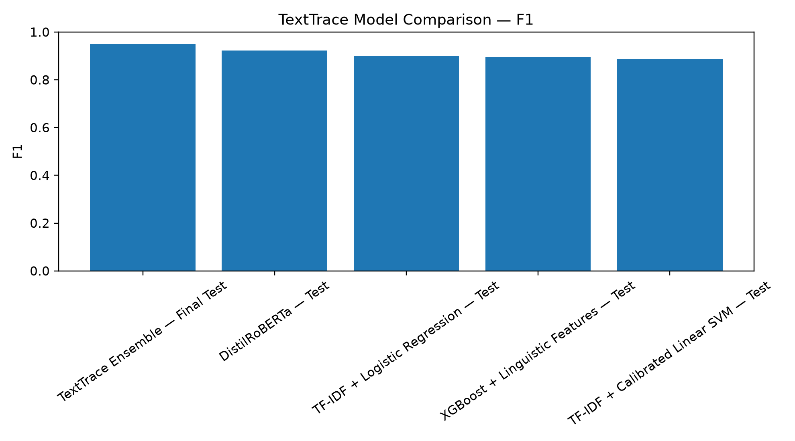
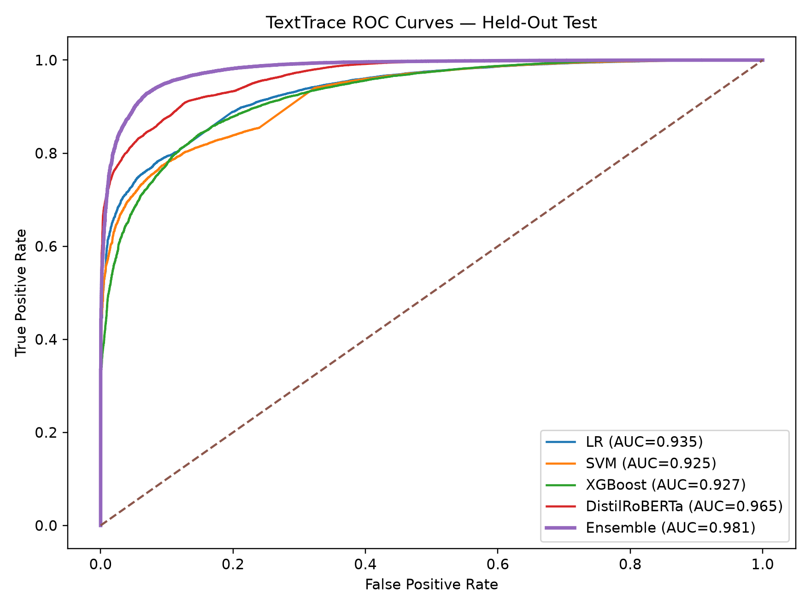

<div align="center">

# 🔍 TextTrace

### AI-Generated Text Detection Studio

*Upload a document → detect AI-written passages → get a highlighted, report-ready result.*


</div>

---

## 📖 About

**TextTrace** checks whether text in a PDF or Word document was written by a human or by AI. It scores each passage with a weighted ensemble of four machine-learning models trained on the [RAID benchmark](https://huggingface.co/datasets/liamdugan/raid) (500k-sample subset). Suspect passages are highlighted in the original document, and the results can be downloaded as PDF, DOCX or HTML reports.

---

## ✨ Features

| | Feature | Description |
|---|---|---|
| 📄 | **Document upload** | PDF and DOCX text extraction |
| 🤖 | **AI-writing detection** | Each passage is scored by a 4-model ensemble and flagged above a tuned threshold |
| 🖍️ | **In-document highlighting** | Flagged passages are highlighted in the original PDF/DOCX, with a summary cover page |
| 🔗 | **Similarity review** | TF-IDF cosine similarity against your own local `repository/` folder |
| 📊 | **Reports** | Polished PDF report, annotated DOCX/PDF and an HTML review page |
| 🔁 | **Adaptive learning** | Trains a *candidate* model from reviewer-verified feedback, without touching production |
| 🛡️ | **Robustness tested** | Evaluated against 11 RAID adversarial attacks |

---

## 🛠️ Tech Stack

| Layer | Tools |
|---|---|
| 🖥️ **Frontend / UI** | Streamlit (custom dark theme) |
| 🧠 **Deep learning** | PyTorch, Hugging Face Transformers (fine-tuned `distilroberta-base`) |
| 📈 **Classical ML** | scikit-learn (TF-IDF + Logistic Regression, Calibrated Linear SVM), XGBoost |
| 📑 **Document processing** | PyMuPDF (`fitz`), python-docx, lxml, docx2pdf / LibreOffice |
| 🧾 **Reporting** | ReportLab |
| 🧮 **Data** | pandas, NumPy, joblib |
| 🧪 **Testing** | pytest |
| 📓 **Experimentation** | Jupyter Notebook |

---

## 🏆 Model Results

Results on the held-out test set (74,813 samples):

| Model | F1 | ROC-AUC | Accuracy |
|---|:---:|:---:|:---:|
| 🥇 **TextTrace Ensemble** (threshold 0.56) | **0.952** | **0.981** | **0.934** |
| 🥈 DistilRoBERTa (fine-tuned) | 0.923 | 0.965 | 0.892 |
| 🥉 TF-IDF + Logistic Regression | 0.899 | 0.935 | 0.862 |
| XGBoost + Linguistic Features | 0.896 | 0.927 | 0.855 |
| TF-IDF + Calibrated Linear SVM | 0.888 | 0.925 | 0.835 |

⚖️ **Ensemble weights:** LR 0.38 · XGBoost 0.36 · DistilRoBERTa 0.25 · SVM 0.003

🛡️ **Adversarial robustness:** F1 stays above **0.96** for most attacks (case changes, misspellings, synonyms, whitespace, article deletion). It drops to about **0.90** for paraphrasing and zero-width-space insertion. See [`reports/attack_results.csv`](reports/attack_results.csv).

<p align="center">
  
  
</p>

---

## 📁 Project Structure

```
TextTrace/
├── 🚀 app.py                               # Streamlit app: upload, analysis, AI review, similarity, reports, settings
├── 📦 texttrace/
│   ├── engine.py                           # Document loading, ensemble scoring, similarity, annotation, reports
│   ├── annotate.py                         # Highlighting helpers
│   └── report.py                           # PDF report builder
├── 🧠 models/
│   ├── ensemble_config.json                # Model weights, threshold, label mapping
│   ├── tfidf_logistic_regression.pkl
│   ├── tfidf_calibrated_linear_svm.pkl
│   ├── xgboost_linguistic.pkl
│   ├── adaptive_logistic_regression.pkl
│   └── distilroberta_texttrace/            # Tokenizer + config (weights not in repo, see below)
├── 📊 reports/
│   ├── charts/                             # Confusion matrix, ROC, F1, XAI, robustness charts
│   └── *.csv                               # Evaluation results, error analysis, feature importance
├── 🖼️ Streamlit Screenshot/                # App screenshots
├── 🧪 tests/
│   └── test_imports.py                     # Import smoke test
├── 🔬 texttrace_ml_pipeline_final.py       # Full training pipeline: sampling, models, evaluation, XAI, attacks
├── 📓 TextTrace_Final_ML_Experiment.ipynb  # Notebook version of the experiment
├── 📕 JupyterNotebook code and ouput.pdf   # PDF export of the notebook
├── 🔁 train_adaptive.py                    # Candidate model training from verified feedback
├── 📋 requirements.txt
└── 📘 README.md
```

---

## 🚀 Getting Started

### 1️⃣ Clone the repository

```bash
git clone https://github.com/sayyadsuzain9001/TextTrace.git
cd TextTrace
```

### 2️⃣ Create a virtual environment

```bash
python -m venv venv
venv\Scripts\activate          # Windows
source venv/bin/activate       # macOS / Linux
```

### 3️⃣ Install dependencies

```bash
pip install -r requirements.txt
```

### 4️⃣ Run the app

```bash
streamlit run app.py
```

Then open **http://localhost:8501** in your browser. 🎉

---

## ⚙️ Configuration Notes

> [!NOTE]
> **Large files are not in the repository.** The fine-tuned DistilRoBERTa weights (`model.safetensors`, ~330 MB) and the RAID data splits in `data/processed/` (several GB) are over GitHub's file size limit. To use the transformer model, re-run `texttrace_ml_pipeline_final.py` or copy the weights into `models/distilroberta_texttrace/`. The scikit-learn and XGBoost models are included.

- 🔗 **Similarity checking:** create a `repository/` folder next to `app.py` and add reference documents. TextTrace compares uploads only against these files and doesn't search the web.
- 📝 **DOCX → PDF:** making a highlighted PDF from a DOCX upload needs Microsoft Word (via `docx2pdf`) or LibreOffice installed.
- 🔐 **No API keys** are required.

---

## 🧪 Running Tests

```bash
pytest tests
```

---

## 📸 Screenshots

<p align="center">
  <br>
  <em>Dashboard</em>
</p>

<p align="center">
  
  <br>
  <em>Upload page and analysis output</em>
</p>

<p align="center">
  
  <br>
  <em>AI-highlighted document and report downloads</em>
</p>

---

## ⚠️ Limitations

AI-text detection is probabilistic. TextTrace's scores should **support, not replace, human judgement**. On the test set, about 12% of human-written samples were wrongly flagged as AI (false positive rate).

---

<div align="center">

Made with ❤️ by [sayyadsuzain9001](https://github.com/sayyadsuzain9001)

⭐ If you find this project useful, give it a star!

</div>
